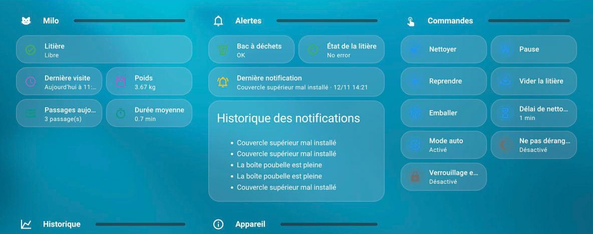
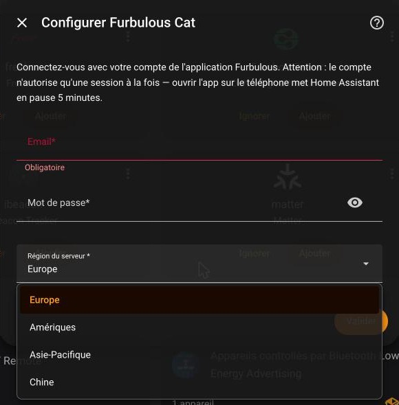
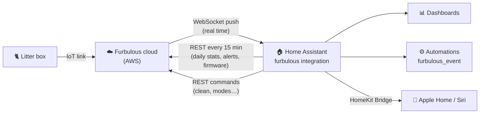
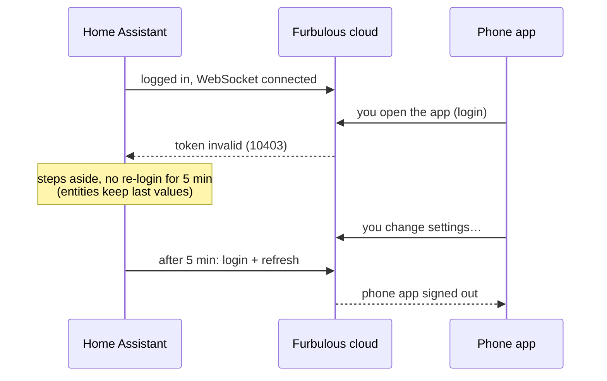
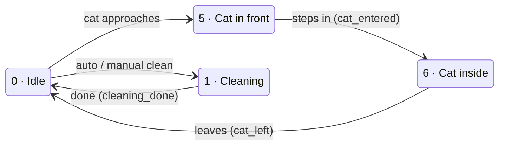
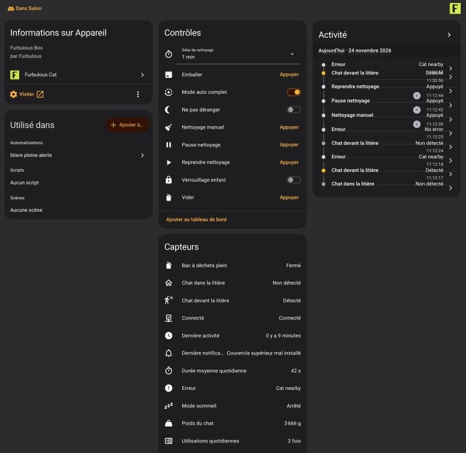
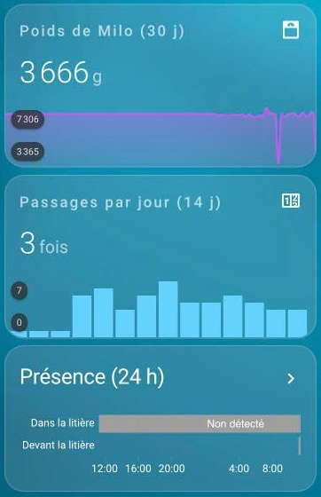

<div align="center">


# Furbulous Cat for Home Assistant

**Real-time integration for the Furbulous self-cleaning litter box: cat presence, weight, visits, alerts and controls, in Home Assistant and Apple Home.**

[](https://github.com/hacs/integration)
[](https://github.com/FabienBounoir/furbulous-litterbox-home-assistant/releases)


[](https://my.home-assistant.io/redirect/hacs_repository/?owner=FabienBounoir&repository=furbulous-litterbox-home-assistant&category=integration)

</div>



---

## ✨ Highlights

- ⚡ **Real time, not polling.** Uses the same WebSocket push channel as the official app: the cat is detected about 1 s after stepping in, with far less data than polling every 30 s.
- 🐈 **Knows the difference** between a cat *in front of* the box, a cat *inside*, and a cleaning cycle.
- 🎯 **Automation events** (`furbulous_event`): cat nearby, cat entered, cat left with visit duration and weight, cleaning done.
- 🔔 **Official alerts** (waste bin full, lid not installed…) as a sensor and as a `furbulous_notification` event.
- 📱 **Plays nice with the phone app.** The account allows a single session: when you open the app, the integration steps aside for 5 minutes, then reconnects by itself.
- 🌍 **All regions** (Europe, Americas, Asia-Pacific, China) and **5 languages**.
- 🍎 **HomeKit-friendly** entity types (occupancy, motion, switches).
- 🩺 **Diagnostics** download with credentials redacted, for bug reports.

---

## 📦 Installation

### HACS (recommended)

1. Click the **Add repository to HACS** button above, or add `https://github.com/FabienBounoir/furbulous-litterbox-home-assistant` as a custom repository (category **Integration**).
2. Download **Furbulous Cat** and restart Home Assistant.

### Manual

Copy `custom_components/furbulous` into your `config/custom_components/` folder and restart Home Assistant.

### Configuration

**Settings → Devices & services → Add integration → Furbulous Cat**, then sign in with your Furbulous app account and pick the server region your app uses.



> [!IMPORTANT]
> Furbulous accounts allow **one session at a time**. Logging into the phone app signs Home Assistant out (and vice versa). The integration handles this: it waits **5 minutes** so you can use the app, then logs back in. Entities keep their last value in the meantime.

---

## 🧭 How it works



Every property change (presence, weight, cleaning state, errors) arrives instantly over the WebSocket. REST is only used for commands, daily statistics, alerts and firmware info, and as a safety net.

### Single-session handling



### Litter box states



---

## 🧩 Entities



| Type | Entity | Notes |
|---|---|---|
| Binary sensor | **Cat in litter box** | `occupancy`, real time (`workstatus` 6) |
| Binary sensor | **Cat in front of litter box** | `motion`, entrance presence sensor (`workstatus` 5) |
| Binary sensor | Waste bin full · Connected · Child lock · Sleep mode | |
| Sensor | **Last activity** | Time of the last visit, with `duration_seconds` and `cat_weight` attributes |
| Sensor | Cat weight · Daily uses · Average daily duration · Error | Daily stats refresh as soon as the cat leaves |
| Sensor | **Last notification** | Text of the latest app alert, plus the 5 most recent in `recent` |
| Button | Manual clean · Pause · Resume · Empty litter · Pack waste | |
| Switch | Full auto mode · Do not disturb · Child lock | |
| Select | Cleaning delay | |
| Update | **Firmware** | MCU and Wi-Fi versions (read-only: install updates from the app) |

Entity names are translated (EN, FR, DE, ES, IT) and follow your Home Assistant language.

---

## ⚙️ Automations

### Events

| Event | `type` / data | When |
|---|---|---|
| `furbulous_event` | `cat_nearby` | A cat is in front of the box |
| `furbulous_event` | `cat_entered` | The cat steps in |
| `furbulous_event` | `cat_left` + `duration` (s), `weight` (g), `end` | The cat leaves |
| `furbulous_event` | `cleaning_done` | A cleaning cycle finished |
| `furbulous_notification` | `title`, `summary`, `time` | New alert in the app (bin full, lid…) |

All events also carry `iotid` and `device_name`.

### Examples

```yaml
# Long visit: possible health issue
- alias: "Litter box: long visit"
  triggers:
    - trigger: event
      event_type: furbulous_event
      event_data: { type: cat_left }
  conditions:
    - "{{ (trigger.event.data.duration or 0) > 300 }}"
  actions:
    - action: notify.notify
      data:
        message: >
          Visit of {{ trigger.event.data.duration // 60 }} min
          ({{ trigger.event.data.weight }} g)

# Forward the app's own alerts
- alias: "Litter box: app alerts"
  triggers:
    - trigger: event
      event_type: furbulous_notification
  actions:
    - action: notify.notify
      data:
        title: "{{ trigger.event.data.title }}"
        message: "{{ trigger.event.data.summary }}"

# Night light when the cat walks up to the box
- alias: "Litter box: night light"
  triggers:
    - trigger: state
      entity_id: binary_sensor.furbulous_box_cat_in_front_of_litter_box
      to: "on"
  conditions:
    - condition: sun
      after: sunset
  actions:
    - action: light.turn_on
      target: { entity_id: light.hallway }
      data: { brightness_pct: 10 }
```

---

## 📊 Dashboard



The screenshots come from a dashboard built with [Mushroom](https://github.com/piitaya/lovelace-mushroom), [Bubble Card](https://github.com/Clooos/Bubble-Card) and [mini-graph-card](https://github.com/kalkih/mini-graph-card). Things worth showing:

- a **status card** driven by the `work_status_code` attribute of *Cat in litter box* (0 idle, 1 cleaning, 5 in front, 6 inside);
- **last visit** from *Last activity*, with its `duration_seconds` attribute;
- a **weight trend** (30 days) and **daily uses** as bars (`group_by: date`);
- a **presence timeline** (history graph of *in* and *in front*).

<br clear="right">

---

## 🍎 HomeKit

Expose the entities through the built-in **HomeKit Bridge**:

| Entity | Apple Home accessory |
|---|---|
| Cat in litter box | Occupancy sensor, real time, usable in Home automations |
| Cat in front of litter box | Motion sensor |
| Waste bin full | Occupancy sensor by default. **Tip:** set *Show as → Opening* in the entity settings to get a contact sensor and native Apple Home notifications ("open" = full) |
| Buttons and switches | Switches (buttons turn themselves off) |

Apple Home has no generic numeric or text sensor, so weight, statistics, errors and notifications stay in Home Assistant. Consider excluding **Empty litter** and **Pack waste** from HomeKit: Home has no confirmation step.

---

## 🔍 Decoded values

| `workstatus` | Meaning |
|---|---|
| 0 | Idle |
| 1 | Cleaning |
| 5 | Cat in front of the box |
| 6 | Cat inside |

| `errorReportEvent` | Meaning |
|---|---|
| 0 | No error |
| 16 | Litter full |
| 64 | Drawer not in place |
| 128 | Cover open |
| 4096 | Cat nearby (informational, not an error) |

Found another value? Download the diagnostics (**Settings → Devices → Furbulous Box → ⋮ → Download diagnostics**). Credentials are redacted. Open an issue with the file and what the box was doing.

---

## 🛠️ Development

```bash
python tests/test_kick.py   # session handling + value normalization (needs `requests`)
```

API notes from reverse engineering the Android app live in [`docs/`](docs). PRs welcome!

## 📄 License

MIT. See [LICENSE](LICENSE). Not affiliated with Furbulous.
